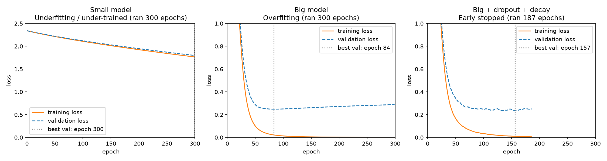

# Digit Classification: Underfitting, Overfitting, and Regularisation

This project compares three PyTorch classifiers on the 8×8 handwritten-digits
dataset provided by scikit-learn. It demonstrates how model capacity,
regularisation, validation-based checkpointing, and early stopping affect
training and generalisation.

## Objectives

- Train a small linear model and two larger neural networks.
- Compare training and validation loss to observe underfitting and overfitting.
- Evaluate dropout, weight decay, and early stopping as regularisation methods.
- Save the best validation checkpoint, test metrics, and loss-curve figure.

## Implementation

The experiment is implemented in [`p1_train.py`](p1_train.py). It loads the
scikit-learn digits dataset, scales pixel values from 0–16 to 0–1, and creates
stratified train, validation, and test splits of 200, 798, and 799 examples.
The random seed is fixed at 0.

The three model configurations are:

1. **Small:** one linear layer mapping 64 input features to 10 digit classes,
   trained with SGD.
2. **Big:** two 256-unit ReLU hidden layers, trained with Adam.
3. **Big + dropout + decay:** the same hidden-layer sizes, with dropout (0.3),
   AdamW weight decay (0.05), and early stopping (patience 30).

Each run records training and validation cross-entropy loss. The best
validation-loss model is saved as a PyTorch state dictionary. The script writes
the results table to `results.csv` and loss plots to `curves.png`.

## Results

The checked-in results are:

| Model | Final training loss | Best validation loss | Test accuracy |
|---|---:|---:|---:|
| Small | 1.767 | 1.800 (epoch 300) | 0.751 |
| Big (after 300 epochs) | 0.001 | 0.248 (epoch 84) | 0.934 |
| Big (best checkpoint) | 0.001 | 0.248 (epoch 84) | 0.937 |
| Big + dropout + decay (best checkpoint) | 0.006 | 0.234 (epoch 157) | 0.937 |

The small model's relatively high training loss indicates it is
under-capacity or under-trained. The larger model drives training loss close
to zero while its validation loss rises after its best epoch, illustrating
overfitting. Dropout and weight decay with early stopping improve the best
validation loss and match the best-checkpoint test accuracy in this run.

### Training and validation loss curves



## Project files

- `p1_train.py` — training, evaluation, checkpointing, and plotting.
- `requirements.txt` — Python package dependencies.
- `results.csv` — recorded test and validation results.
- `curves.png` — visual comparison of training and validation loss.
- `best_small.pt`, `best_big.pt`, `best_reg.pt` — saved model state
  dictionaries selected by validation loss.

## Setup and usage

Requires Python 3 and the packages listed in `requirements.txt`.

1. Clone the repository and enter its directory.
2. Create and activate a virtual environment (recommended).
3. Install dependencies:

   ```sh
   python -m pip install -r requirements.txt
   ```

4. Run the experiment:

   ```sh
   python p1_train.py
   ```

The script prints the split sizes and results table, then overwrites the
checkpoint files, `results.csv`, and `curves.png` in the current directory.
The digits dataset is downloaded/provided by scikit-learn; no separate dataset
file is required.

## Limitations

- The training set contains only 200 examples; results can be sensitive to
  this small sample and the fixed random seed.
- The experiment uses one train/validation/test split and a single run per
  model, so it does not report uncertainty or performance across seeds.
- The test set is used for final comparison only; hyperparameters are not
  systematically tuned.
- Accuracy is the only reported test metric, and the experiment is limited to
  scikit-learn's small, low-resolution digits dataset.
- Checkpoint files contain model weights (state dictionaries), not a
  standalone inference program or full training state.
